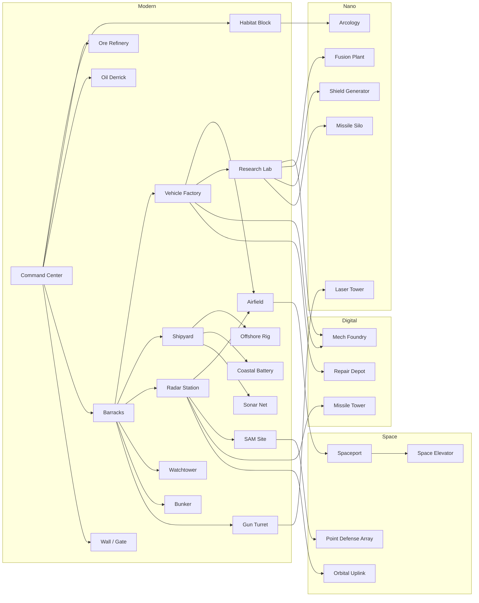

# Tech tree and catalog

Everything a player can build, train and research, by age. All numbers are **starting
values** for the balance harness to tune. Once `src/data/` exists, the tables in this file
are generated from it by `tools/gen-docs.mjs`, so the docs and the game never disagree.

Costs are written `Ore / Energy`. Times are in seconds at normal game speed.

---

## 1. Ages

| Age | Theme | Advance cost | Time | Requirements (at the HQ) |
|---|---|---|---|---|
| **Modern** | Start. Tanks, destroyers, jets, concrete walls | — | — | — |
| **Digital** | Nuclear subs, carriers, stealth, first mech | 1200 / 800 | 60 | 2 of: Barracks, Vehicle Factory, Shipyard, Airfield |
| **Nano** | Heavy mechs, lasers, shields, EMP, nukes | 2500 / 2000 | 90 | Research Lab + Mech Foundry |
| **Space** | Orbital units, orbital strikes, Space Elevator wonder | 4000 / 3500 | 120 | Nano Age + Missile Silo or Shield Generator |

Advancing also upgrades all existing walls one tier (see §4) and unlocks that age's research.

---

## 2. Building prerequisites

---

## 3. Buildings by category

| Building | Category | Age | Requires | Cost | Pop | Function |
|---|---|---|---|---|---|---|
| **Command Center** | Core | Modern | — | 1000 / 0 | +10 | Trains Engineers, resource drop-off, age advancement. Can garrison 10 infantry |
| **Habitat Block** | Housing | Modern | HQ | 100 / 0 | +10 | Population capacity |
| **Arcology** | Housing | Nano | Habitat | 300 / 150 | +30 | Large housing; slowly heals nearby infantry |
| **Ore Refinery** | Resource | Modern | HQ | 150 / 0 | — | Ore drop-off; mining research |
| **Oil Derrick** | Resource | Modern | HQ | 100 / 0 | — | Built on land oil; produces Energy passively |
| **Offshore Rig** | Resource | Modern | Shipyard | 200 / 0 | — | Built on sea oil by a Sea Engineer; richer than land oil, exposed to navies |
| **Fusion Plant** | Resource | Nano | Research Lab | 600 / 0 | — | Produces Energy anywhere; explodes when destroyed |
| **Barracks** | Military | Modern | HQ | 200 / 0 | — | Infantry |
| **Vehicle Factory** | Military | Modern | Barracks | 300 / 100 | — | Land vehicles |
| **Shipyard** | Military | Modern | Barracks | 300 / 100 | — | Ships and subs. Coastal placement |
| **Airfield** | Military | Modern | Radar + Factory | 350 / 200 | — | Aircraft; rearms and repairs them |
| **Mech Foundry** | Military | Digital | Research Lab + Factory | 600 / 400 | — | Giant mechs |
| **Spaceport** | Military | Space | Airfield | 800 / 800 | — | Orbital units |
| **Radar Station** | Tech | Modern | Barracks | 200 / 50 | — | Large vision radius, shows enemy blips on minimap, detects stealth aircraft |
| **Research Lab** | Tech | Modern | Factory | 300 / 200 | — | Global research; required for Digital→Nano path |
| **Repair Depot** | Support | Digital | Factory | 250 / 100 | — | Repairs vehicles and mechs nearby |
| **Missile Silo** | Special | Nano | Research Lab | 1500 / 1500 | — | Nuclear strike every 5 min. Enemy is warned 15 s before impact |
| **Orbital Uplink** | Special | Space | Radar | 1000 / 1200 | — | Orbital laser strike (narrow, deadly) and satellite scan powers |
| **Space Elevator** | Wonder | Space | Spaceport | 5000 / 5000 | — | Build it and hold it for 5 min to win. Revealed to all players |
| *Defense buildings* | Defense | | | | | See §4 |

---

## 4. Defense: walls and towers

Turtling must be a real strategy, not a delay. Design rules:

- **Walls are cheap and fast.** Drag to draw a line; segments auto-connect and snap to
  cliffs and coasts. Gates open for your units only. Walls block land pathing.
- **Garrisoned towers are strong.** Infantry inside a Watchtower, Bunker, Missile Tower or
  the HQ fire from it with **+2 range, +50% damage reduction**, and the structure adds its
  own weapon. Each garrisoned unit adds firepower, so a full tower is a serious threat.
- **Height matters.** Towers get a range bonus and see over walls.
- **Walls get stronger with the ages.** Every age-up upgrades existing walls a tier.
- **Siege is a choice, not a given.** Artillery, bombers, mechs, EMP and nukes are the
  counters. Attacking a fortified base without them should fail. Attacking with them
  should win, but cost real investment.
- **Engineers repair** walls and towers (Energy-free, Ore cost proportional to damage).

| Structure | Age | Requires | Cost | Garrison | Targets | Notes |
|---|---|---|---|---|---|---|
| **Wall segment** | Modern | HQ | 10 / 0 per segment | — | — | Concrete → Composite (Digital) → Nanocrete, self-repairing (Nano) → Hardlight, blocks shots too (Space) |
| **Gate** | Modern | Wall | 50 / 0 | — | — | Opens for own units; lockable |
| **Watchtower** | Modern | Barracks | 125 / 0 | 4 infantry | Ground, (air if garrisoned AA infantry) | Built into wall lines. Tall: +vision, +range |
| **Bunker** | Modern | Barracks | 200 / 0 | 6 infantry | Ground | Very high armor, low profile, weak to artillery |
| **Gun Turret** | Modern | Barracks | 150 / 25 | — | Ground | Auto-cannon. Good vs light vehicles |
| **SAM Site** | Modern | Radar | 200 / 100 | — | Air | Long range anti-air |
| **Coastal Battery** | Modern | Shipyard | 300 / 100 | — | Ships | Long range heavy guns on the shore |
| **Sonar Net** | Modern | Shipyard | 100 / 50 | — | — | Placed on water. Reveals submerged subs nearby. Cheap counter to subs |
| **Missile Tower** | Digital | Radar | 350 / 200 | 4 infantry | Ground + air | Upgrade of Watchtower possible in place |
| **Laser Tower** | Nano | Gun Turret | 400 / 300 | — | Ground | Beam ramps up on the same target: shreds mechs and heavy armor |
| **Shield Generator** | Nano | Research Lab | 800 / 600 | — | — | Dome absorbs damage on buildings inside until depleted, recharges |
| **Point Defense Array** | Space | SAM Site | 700 / 700 | — | Projectiles | Shoots down missiles, artillery shells, bombs and incoming nukes in its radius |

Defense research:

| Research | At | Age | Cost | Effect |
|---|---|---|---|---|
| Fortified Masonry | HQ | Modern | 150 / 0 | Walls and gates +30% HP |
| Murder Holes | Barracks | Modern | 100 / 50 | Garrisoned infantry +1 more range |
| Targeting Radar | Radar Station | Modern | 200 / 100 | All towers and turrets +15% range |
| Hardened Garrison | Barracks | Digital | 300 / 200 | Garrison damage reduction 50% → 70% |
| Automated Repair | Research Lab | Digital | 400 / 300 | Defensive structures slowly self-repair out of combat |
| Overcharged Lasers | Research Lab | Nano | 600 / 500 | Laser Tower ramp-up twice as fast |
| Layered Shields | Research Lab | Space | 800 / 800 | Shield Generator capacity +50% |

---

## 5. Units

Armor classes: **Inf** infantry, **Lt** light vehicle, **Hv** heavy vehicle, **Mech**, **Ship**,
**Sub**, **Air**, **Orb** orbital, **Str** structure.

### Engineers (all ages)

| Unit | From | Cost | Pop | Notes |
|---|---|---|---|---|
| Engineer | HQ | 50 / 0 | 1 | Gathers Ore, builds, repairs. Can garrison |
| Sea Engineer | Shipyard | 120 / 0 | 1 | Builds Offshore Rigs and Sonar Nets |

### Modern age

| Unit | From | Class | Cost | Pop | Strong vs | Weak vs |
|---|---|---|---|---|---|---|
| Rifleman | Barracks | Inf | 50 / 0 | 1 | Inf | Lt, artillery |
| Rocket Trooper | Barracks | Inf | 80 / 20 | 1 | Lt, Hv | Inf |
| Skyguard | Barracks | Inf | 80 / 30 | 1 | Air (helicopters) | Inf, Lt |
| Scout Buggy | Factory | Lt | 80 / 20 | 1 | Inf, scouting | Hv, turrets |
| Battle Tank | Factory | Hv | 250 / 75 | 3 | Lt, Hv | Rocket Trooper, helicopters |
| Flak Track | Factory | Lt | 150 / 50 | 2 | Air | Hv |
| Howitzer | Factory | Hv | 300 / 100 | 3 | Str, Inf (long range, min range) | anything up close |
| Patrol Boat | Shipyard | Ship | 120 / 30 | 2 | Inf on shore, Sub (depth charges) | Destroyer |
| Destroyer | Shipyard | Ship | 400 / 150 | 4 | Ship, Sub | Air |
| Frigate | Shipyard | Ship | 300 / 150 | 3 | Air | Ship |
| Transport Ship | Shipyard | Ship | 200 / 50 | 2 | — | carries 10 land slots (inf = 1, vehicle = 3) |
| Fighter Jet | Airfield | Air | 250 / 150 | 2 | Air | SAM, Flak |
| Attack Helicopter | Airfield | Air | 300 / 150 | 3 | Lt, Hv | Fighter, Skyguard |

### Digital age

| Unit | From | Class | Cost | Pop | Strong vs | Weak vs |
|---|---|---|---|---|---|---|
| Exo-Trooper | Barracks | Inf | 150 / 75 | 2 | Inf, Lt; can garrison like infantry | Hv |
| Rocket Artillery | Factory | Hv | 450 / 250 | 4 | Str, groups (area damage, huge range) | fast units, air |
| **Nuclear Submarine** | Shipyard | Sub | 700 / 400 | 5 | Ship (torpedoes). **Submerged = invisible** unless in sonar/destroyer range. With *Cruise Missiles* research: strikes land targets | Destroyer, Patrol Boat, Sonar Net |
| **Aircraft Carrier** | Shipyard | Ship | 1200 / 700 | 8 | Carries up to 6 Fighter Jets: launch, recall, rearm and repair at sea. Projects air power to any coast | Subs, alone it is nearly defenceless |
| Aegis Cruiser | Shipyard | Ship | 650 / 400 | 5 | Air, missiles; escorts carriers | Sub |
| Stealth Bomber | Airfield | Air | 600 / 400 | 4 | Str, Hv. Invisible unless near Radar/SAM/Aegis | Fighter once detected |
| **Warden** (light mech) | Mech Foundry | Mech | 900 / 500 | 6 | Inf, Lt; walks over walls' rubble and shallow water | Rocket Troopers in numbers, Laser Tower |

### Nano age

| Unit | From | Class | Cost | Pop | Strong vs | Weak vs |
|---|---|---|---|---|---|---|
| Disruptor | Factory | Lt | 400 / 300 | 3 | **EMP pulse** stuns mechs and vehicles, drains shields | Inf |
| **Juggernaut** (heavy assault mech) | Mech Foundry | Mech | 1800 / 1200 | 10 | Str, Hv. Arm cannons, smashes walls | Disruptor, Arclight, Laser Tower |
| **Arclight** (laser mech) | Mech Foundry | Mech | 1500 / 1300 | 8 | Mech, Hv (eye laser) | Inf swarms, air |
| **Leviathan** (amphibious mech) | Mech Foundry | Mech | 2000 / 1500 | 10 | Walks across the seabed (submerged = hidden), surfaces to attack ships or land | Subs, Disruptor |
| Nano Swarm | Research Lab | Air | 200 / 200 | 2 | Repairs friendly units in an area | everything (fragile) |

### Space age

| Unit | From | Class | Cost | Pop | Strong vs | Weak vs |
|---|---|---|---|---|---|---|
| Orbital Fighter | Spaceport | Orb | 600 / 600 | 3 | Air, Orb | Point Defense, SAM (reduced) |
| Drop Ship | Spaceport | Orb | 800 / 800 | 4 | Carries 1 mech or 10 infantry anywhere on the map, lands behind walls | anti-air |
| Star Lance (capital ship) | Spaceport | Orb | 3000 / 3000 | 15 | Everything below it. Max 1 per player | Orbital Fighters in numbers, orbital laser |

Unit caps: max 1 Star Lance, max 2 Aircraft Carriers in Digital (3 in Nano+).

---

## 6. Damage vs armor

Damage multiplier by weapon type (rows) against armor class (columns). `—` = cannot target.

| | Inf | Lt | Hv | Mech | Ship | Sub | Air | Orb | Str |
|---|---|---|---|---|---|---|---|---|---|
| Bullet | 1.0 | 0.6 | 0.2 | 0.15 | 0.2 | — | 0.3 | — | 0.15 |
| Armor-piercing | 0.4 | 1.2 | 1.0 | 0.8 | 0.8 | — | — | — | 0.6 |
| Explosive (artillery/bombs) | 1.2 | 0.9 | 0.7 | 0.6 | 0.7 | — | — | — | 1.5 |
| Anti-air missile | — | — | — | — | — | — | 1.5 | 0.8 | — |
| Torpedo / depth charge | — | — | — | 0.8* | 1.5 | 1.5 | — | — | 0.5* |
| Laser | 0.8 | 1.0 | 1.3 | 1.5 | 1.0 | — | 1.0 | 1.0 | 0.8 |
| EMP | stun 0 | stun | stun | stun ×2 | stun | — | — | — | shields |

\* Torpedo vs mech applies to Leviathan in water; vs structures to coastal buildings.

---

## 7. Research by building and age

| Building | Modern | Digital | Nano | Space |
|---|---|---|---|---|
| **Command Center** | Fortified Masonry; Efficient Logistics (build speed +20%) | Command Network (+5 garrison slots in HQ) | — | Planetary Defense Grid (HQ gains a PDA) |
| **Ore Refinery** | Deep Drilling (+15% ore) | Automated Mining (+20%) | Nano Extraction (+25%) | Asteroid Capture (passive ore trickle) |
| **Barracks** | Body Armor; Murder Holes | Hardened Garrison; Exoskeletons (inf speed) | Nano Weave (inf regen) | — |
| **Vehicle Factory** | Composite Armor | Reactive Armor; Railguns (tank +range) | Hover Drives (vehicles cross shallow water) | — |
| **Shipyard** | Sonar (+sub detection range) | Cruise Missiles (subs hit land); Nuclear Propulsion (+ship speed) | Supercavitation (torpedo speed) | — |
| **Airfield** | Afterburners | Stealth Coating; Precision Munitions | Drone Wingmen (fighters spawn drones) | — |
| **Radar Station** | Targeting Radar | Electronic Warfare (enemy minimap blips scrambled near you) | — | Satellite Network (permanent reveal of enemy HQ) |
| **Research Lab** | Advanced Ballistics | Automated Repair | Shield Tech (unlocks Shield Generator); Overcharged Lasers | Layered Shields; Fusion Engines |
| **Mech Foundry** | — | Reinforced Frames | Overclocked Reactors (mech speed); Ablative Plating | Jump Jets (mechs leap cliffs and walls) |
| **Spaceport** | — | — | — | Orbital Mechanics (orbital unit speed); Kinetic Rods (Star Lance bombardment) |

---

## 8. What counters what (summary)

- **Walls + garrisoned towers** beat early infantry and vehicle rushes → answered by
  **Howitzers / Rocket Artillery / bombers / Juggernauts**.
- **Artillery** → answered by fast units, helicopters, bombers, Laser Towers at range.
- **Nuclear subs** → **Destroyers, Patrol Boats, Sonar Nets**.
- **Carriers** → **subs** (and Leviathans).
- **Stealth bombers** → **Radar + SAM**, Aegis Cruisers.
- **Mechs** → **Disruptors (EMP), Arclights, Laser Towers**, Rocket Troopers en masse.
- **Nukes** → spread out, **Point Defense Array** (Space age).
- **Drop Ships behind walls** → interior towers, Point Defense, Orbital Fighters.
- **Space Elevator** → everything; it forces the defender out of their walls.
