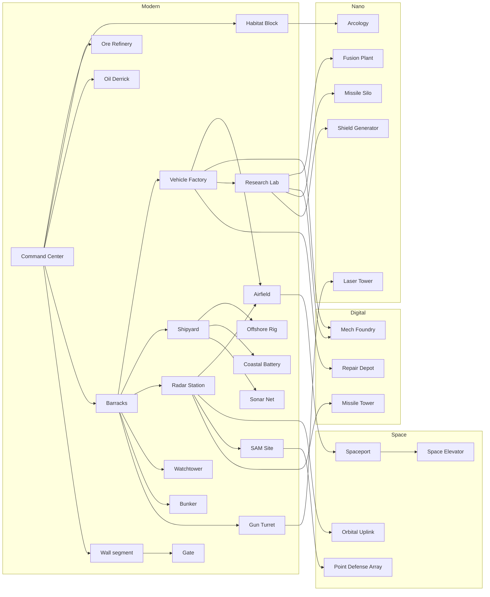

# Tech tree and catalog

Everything a player can build, train and research, by age. All numbers are **starting
values** for the balance harness to tune. The tables and the diagram in this file are
generated from `src/data/` by `npm run docs` (CI fails if they drift), so the docs and the
game never disagree. Edit the data, not the tables.

Costs are written `Ore / Energy`. Times are in seconds at normal game speed.

---

## 1. Ages

<!-- gen:ages -->
| Age | Theme | Advance cost | Time | Requirements (at the HQ) |
|---|---|---|---|---|
| **Modern** | Start. Tanks, destroyers, jets, concrete walls | — | — | — |
| **Digital** | Nuclear subs, carriers, stealth, first mech | 1200 / 800 | 60 | 2 of: Barracks, Vehicle Factory, Shipyard, Airfield |
| **Nano** | Heavy mechs, lasers, shields, EMP, nukes | 2500 / 2000 | 90 | Research Lab + Mech Foundry |
| **Space** | Orbital units, orbital strikes, Space Elevator wonder | 4000 / 3500 | 120 | 1 of: Missile Silo, Shield Generator |
<!-- /gen:ages -->

Advancing also upgrades all existing walls one tier (see §4) and unlocks that age's research.

---

## 2. Building prerequisites

<!-- gen:prereq_diagram -->

<!-- /gen:prereq_diagram -->

---

## 3. Buildings by category

<!-- gen:buildings -->
| Building | Category | Age | Requires | Cost | Build time | Size | Pop | Function |
|---|---|---|---|---|---|---|---|---|
| **Command Center** | Core | Modern | — | 1000 / 0 | 120 | 4×4 | +10 | Trains Engineers, accepts Ore, advances the age. Can garrison 10 infantry. |
| **Habitat Block** | Housing | Modern | Command Center | 100 / 0 | 20 | 2×2 | +10 | Housing: +10 population. |
| **Arcology** | Housing | Nano | Habitat Block | 300 / 150 | 45 | 3×3 | +30 | Large housing: +30 population. Slowly heals nearby infantry. |
| **Ore Refinery** | Resource | Modern | Command Center | 150 / 0 | 30 | 3×3 | — | Ore drop-off. Build it next to ore fields to shorten trips. Mining research. |
| **Oil Derrick** | Resource | Modern | Command Center | 100 / 0 | 25 | 2×2 | — | Built on land oil. Produces Energy on its own. Produces 1.5 energy/s. |
| **Offshore Rig** | Resource | Modern | Shipyard | 200 / 0 | 40 | 3×3 | — | Built on sea oil by a Sea Engineer. Pumps 2.5 oil/s into its tank; 1/s flows ashore by pipeline, Sea Engineers haul the rest to a Shipyard. Produces 2.5 energy/s. |
| **Fusion Plant** | Resource | Nano | Research Lab | 600 / 0 | 60 | 3×3 | — | Produces Energy anywhere. Explodes when destroyed. Produces 4 energy/s. |
| **Barracks** | Military | Modern | Command Center | 200 / 0 | 35 | 3×3 | — | Trains infantry. |
| **Vehicle Factory** | Military | Modern | Barracks | 300 / 100 | 45 | 4×4 | — | Builds land vehicles. |
| **Shipyard** | Military | Modern | Barracks | 300 / 100 | 45 | 4×4 | — | Builds ships and submarines. Must touch the water. Sea Engineers unload oil here. |
| **Airfield** | Military | Modern | Radar Station + Vehicle Factory | 350 / 200 | 55 | 6×5 | — | Builds aircraft. 4 parking spots where planes land to refuel and repair. |
| **Mech Foundry** | Military | Digital | Research Lab + Vehicle Factory | 600 / 400 | 70 | 5×5 | — | Builds giant mechs. |
| **Spaceport** | Military | Space | Airfield | 800 / 800 | 80 | 5×5 | — | Builds orbital units. |
| **Radar Station** | Tech | Modern | Barracks | 200 / 50 | 30 | 2×2 | — | Large vision radius, enemy blips on the minimap, detects stealth aircraft. |
| **Research Lab** | Tech | Modern | Vehicle Factory | 300 / 200 | 50 | 3×3 | — | Global research. Needed on the path to the Nano Age. |
| **Repair Depot** | Support | Digital | Vehicle Factory | 250 / 100 | 35 | 3×3 | — | Repairs vehicles and mechs nearby. |
| **Missile Silo** | Special | Nano | Research Lab | 1500 / 1500 | 120 | 3×3 | — | Nuclear strike every 5 minutes. The enemy is warned 15 s before impact. Max 1. |
| **Orbital Uplink** | Special | Space | Radar Station | 1000 / 1200 | 90 | 3×3 | — | Orbital laser strike and satellite scan powers. Max 1. |
| **Space Elevator** | Wonder | Space | Spaceport | 5000 / 5000 | 300 | 6×6 | — | Build it and hold it for 5 minutes to win. Revealed to all players. Max 1. |
<!-- /gen:buildings -->

---

## 4. Defense: walls and towers

Turtling must be a real strategy, not a delay. Design rules:

- **Walls are cheap and fast.** Drag to draw a line; segments auto-connect and snap to
  cliffs and coasts. Gates open for your units only. Walls block land pathing.
- **Garrisoned towers are strong.** Infantry inside a Watchtower, Bunker, Missile Tower or
  the HQ fire from it with **+2 range, +50% damage reduction**, and the structure adds its
  own weapon. Each garrisoned unit adds firepower, so a full tower is a serious threat.
- **Height matters.** Towers get a range bonus and see over walls.
- **Walls get stronger with the ages.** Every age-up upgrades existing walls a tier.
- **Siege is a choice, not a given.** Artillery, bombers, mechs, EMP and nukes are the
  counters. Attacking a fortified base without them should fail. Attacking with them
  should win, but cost real investment.
- **Engineers repair** walls and towers (Energy-free, Ore cost proportional to damage).

<!-- gen:defense -->
| Structure | Age | Requires | Cost | Build time | Garrison | Notes |
|---|---|---|---|---|---|---|
| **Wall segment** | Modern | Command Center | 10 / 0 | 4 | — | Drag to draw a line. Concrete → Composite → Nanocrete (self-repairing) → Hardlight (blocks shots). |
| **Gate** | Modern | Wall segment | 50 / 0 | 12 | — | Opens for your units only; lockable. |
| **Watchtower** | Modern | Barracks | 125 / 0 | 20 | 4 infantry | Garrison 4 infantry who fire with +2 range. Tall: extra vision and range. |
| **Bunker** | Modern | Barracks | 200 / 0 | 25 | 6 infantry | Garrison 6 infantry. Very high armor, weak to artillery. |
| **Gun Turret** | Modern | Barracks | 150 / 25 | 20 | — | Auto-cannon. Good against light vehicles. |
| **SAM Site** | Modern | Radar Station | 200 / 100 | 25 | — | Long-range anti-air. |
| **Coastal Battery** | Modern | Shipyard | 300 / 100 | 35 | — | Long-range heavy guns against ships. |
| **Sonar Net** | Modern | Shipyard | 100 / 50 | 15 | — | Placed on water. Reveals submerged submarines nearby. |
| **Missile Tower** | Digital | Radar Station | 350 / 200 | 35 | 4 infantry | Garrisonable; hits ground and air. Can upgrade a Watchtower in place. |
| **Laser Tower** | Nano | Gun Turret | 400 / 300 | 35 | — | Beam ramps up on the same target: shreds mechs and heavy armor. |
| **Shield Generator** | Nano | Research Lab | 800 / 600 | 60 | — | Dome that absorbs damage to buildings inside until depleted, then recharges. |
| **Point Defense Array** | Space | SAM Site | 700 / 700 | 45 | — | Shoots down missiles, shells, bombs and incoming nukes in its radius. |
<!-- /gen:defense -->

Defense research is listed with all other research in §7.

---

## 5. Units

Armor classes: **Inf** infantry, **Lt** light vehicle, **Hv** heavy vehicle, **Mech**, **Ship**,
**Sub**, **Air**, **Orb** orbital, **Str** structure.

### Modern age

<!-- gen:units_modern -->
| Unit | From | Class | Cost | Pop | Train time | Strong vs | Weak vs |
|---|---|---|---|---|---|---|---|
| **Engineer** | Command Center | Inf | 50 / 0 | 1 | 12 | — | everything |
| **Sea Engineer** | Shipyard | Ship | 120 / 0 | 1 | 18 | — | everything |
| **Rifleman** | Barracks | Inf | 50 / 0 | 1 | 10 | infantry | light vehicles, artillery |
| **Rocket Trooper** | Barracks | Inf | 80 / 20 | 1 | 13 | light and heavy vehicles | infantry |
| **Skyguard** | Barracks | Inf | 80 / 30 | 1 | 13 | helicopters | infantry, light vehicles |
| **Scout Buggy** | Vehicle Factory | Lt | 80 / 20 | 1 | 12 | infantry, scouting | heavy vehicles, turrets |
| **Battle Tank** | Vehicle Factory | Hv | 250 / 75 | 3 | 25 | light and heavy vehicles | Rocket Troopers, helicopters |
| **Flak Track** | Vehicle Factory | Lt | 150 / 50 | 2 | 18 | aircraft | heavy vehicles |
| **Howitzer** | Vehicle Factory | Hv | 300 / 100 | 3 | 28 | structures, infantry (long range) | anything up close |
| **Patrol Boat** | Shipyard | Ship | 120 / 30 | 2 | 16 | infantry on shore, submarines | Destroyer |
| **Destroyer** | Shipyard | Ship | 400 / 150 | 4 | 35 | ships, submarines | aircraft |
| **Frigate** | Shipyard | Ship | 300 / 150 | 3 | 30 | aircraft | ships |
| **Transport Ship** | Shipyard | Ship | 200 / 50 | 2 | 22 | — | everything |
| **Fighter Jet** | Airfield | Air | 250 / 150 | 2 | 25 | aircraft | SAM, Flak |
| **Cargo Plane** | Airfield | Air | 250 / 150 | 2 | 30 | drops 8 paratroopers anywhere | fighters, anti-air |
| **Attack Helicopter** | Airfield | Air | 300 / 150 | 3 | 28 | light and heavy vehicles | Fighter, Skyguard |
<!-- /gen:units_modern -->

### Digital age

<!-- gen:units_digital -->
| Unit | From | Class | Cost | Pop | Train time | Strong vs | Weak vs |
|---|---|---|---|---|---|---|---|
| **Exo-Trooper** | Barracks | Inf | 150 / 75 | 2 | 18 | infantry, light vehicles | heavy vehicles |
| **Rocket Artillery** | Vehicle Factory | Hv | 450 / 250 | 4 | 35 | structures, groups (area damage, huge range) | fast units, aircraft |
| **Nuclear Submarine** | Shipyard | Sub | 700 / 400 | 5 | 45 | ships (torpedoes); land targets with Cruise Missiles | Destroyer, Patrol Boat, Sonar Net |
| **Aircraft Carrier** (max 2) | Shipyard | Ship | 1200 / 700 | 8 | 70 | projects air power to any coast (carries 6 Fighter Jets) | submarines; nearly defenceless alone |
| **Aegis Cruiser** | Shipyard | Ship | 650 / 400 | 5 | 40 | aircraft, missiles | submarines |
| **Stealth Bomber** | Airfield | Air | 600 / 400 | 4 | 40 | structures, heavy vehicles | fighters once detected |
| **Warden** | Mech Foundry | Mech | 900 / 500 | 6 | 50 | infantry, light vehicles | massed Rocket Troopers, Laser Tower |
<!-- /gen:units_digital -->

### Nano age

<!-- gen:units_nano -->
| Unit | From | Class | Cost | Pop | Train time | Strong vs | Weak vs |
|---|---|---|---|---|---|---|---|
| **Disruptor** | Vehicle Factory | Lt | 400 / 300 | 3 | 30 | mechs and vehicles (EMP stun), shields | infantry |
| **Juggernaut** | Mech Foundry | Mech | 1800 / 1200 | 10 | 75 | structures, heavy vehicles; smashes walls | Disruptor, Arclight, Laser Tower |
| **Arclight** | Mech Foundry | Mech | 1500 / 1300 | 8 | 65 | mechs, heavy vehicles (eye laser) | infantry swarms, aircraft |
| **Leviathan** | Mech Foundry | Mech | 2000 / 1500 | 10 | 80 | ships and coasts (walks the seabed, hidden while submerged) | submarines, Disruptor |
| **Nano Swarm** | Research Lab | Air | 200 / 200 | 2 | 20 | repairs friendly units in an area | everything (fragile) |
<!-- /gen:units_nano -->

### Space age

<!-- gen:units_space -->
| Unit | From | Class | Cost | Pop | Train time | Strong vs | Weak vs |
|---|---|---|---|---|---|---|---|
| **Orbital Fighter** | Spaceport | Orb | 600 / 600 | 3 | 35 | aircraft, orbital units | Point Defense, SAM (reduced) |
| **Drop Ship** | Spaceport | Orb | 800 / 800 | 4 | 45 | carries 1 mech or 10 infantry anywhere, lands behind walls | anti-air |
| **Star Lance** (max 1) | Spaceport | Orb | 3000 / 3000 | 15 | 150 | everything below it | Orbital Fighters in numbers, orbital laser |
<!-- /gen:units_space -->

Unit caps are shown next to the unit name.

---

## 6. Damage vs armor

Damage multiplier by weapon type (rows) against armor class (columns). `—` = cannot target.

| | Inf | Lt | Hv | Mech | Ship | Sub | Air | Orb | Str |
|---|---|---|---|---|---|---|---|---|---|
| Bullet | 1.0 | 0.6 | 0.2 | 0.15 | 0.2 | — | 0.3 | — | 0.15 |
| Armor-piercing | 0.4 | 1.2 | 1.0 | 0.8 | 0.8 | — | — | — | 0.6 |
| Explosive (artillery/bombs) | 1.2 | 0.9 | 0.7 | 0.6 | 0.7 | — | — | — | 1.5 |
| Anti-air missile | — | — | — | — | — | — | 1.5 | 0.8 | — |
| Torpedo / depth charge | — | — | — | 0.8* | 1.5 | 1.5 | — | — | 0.5* |
| Laser | 0.8 | 1.0 | 1.3 | 1.5 | 1.0 | — | 1.0 | 1.0 | 0.8 |
| EMP | stun 0 | stun | stun | stun ×2 | stun | — | — | — | shields |

\* Torpedo vs mech applies to Leviathan in water; vs structures to coastal buildings.

---

## 7. Research by building and age

<!-- gen:research_grid -->
| Building | Modern | Digital | Nano | Space |
|---|---|---|---|---|
| **Command Center** | Fortified Masonry; Efficient Logistics | Command Network | — | Planetary Defense Grid |
| **Ore Refinery** | Deep Drilling | Automated Mining | Nano Extraction | Asteroid Capture |
| **Barracks** | Body Armor; Murder Holes | Hardened Garrison; Exoskeletons | Nano Weave | — |
| **Vehicle Factory** | Composite Armor | Reactive Armor; Railguns | Hover Drives | — |
| **Shipyard** | Sonar | Cruise Missiles; Nuclear Propulsion | Supercavitation | — |
| **Airfield** | Afterburners | Stealth Coating; Precision Munitions | Drone Wingmen | — |
| **Radar Station** | Targeting Radar | Electronic Warfare | — | Satellite Network |
| **Research Lab** | Advanced Ballistics | Automated Repair | Shield Tech; Overcharged Lasers | Layered Shields; Fusion Engines |
| **Mech Foundry** | — | Reinforced Frames | Overclocked Reactors; Ablative Plating | Jump Jets |
| **Spaceport** | — | — | — | Orbital Mechanics; Kinetic Rods |
<!-- /gen:research_grid -->

Full list, with what each does and from which milestone it works in game:

<!-- gen:research -->
| Research | At | Age | Cost | Time | Effect | In game |
|---|---|---|---|---|---|---|
| **Fortified Masonry** | Command Center | Modern | 150 / 0 | 30 | Walls and gates +30% HP | from M3 |
| **Efficient Logistics** | Command Center | Modern | 200 / 50 | 40 | Build speed +20% | yes |
| **Command Network** | Command Center | Digital | 400 / 300 | 50 | +5 garrison slots in the HQ | from M5 |
| **Planetary Defense Grid** | Command Center | Space | 1000 / 1000 | 80 | HQ gains a Point Defense Array | from M6 |
| **Deep Drilling** | Ore Refinery | Modern | 150 / 50 | 35 | +15% Ore gathering | yes |
| **Automated Mining** | Ore Refinery | Digital | 300 / 150 | 45 | +20% Ore gathering | yes |
| **Nano Extraction** | Ore Refinery | Nano | 600 / 400 | 60 | +25% Ore gathering | yes |
| **Asteroid Capture** | Ore Refinery | Space | 1000 / 1000 | 80 | Passive Ore trickle | from M6 |
| **Body Armor** | Barracks | Modern | 150 / 50 | 35 | Infantry +20% HP | from M3 |
| **Murder Holes** | Barracks | Modern | 100 / 50 | 30 | Garrisoned infantry +1 more range | from M3 |
| **Hardened Garrison** | Barracks | Digital | 300 / 200 | 45 | Garrison damage reduction 50% → 70% | from M5 |
| **Exoskeletons** | Barracks | Digital | 250 / 150 | 40 | Infantry speed +20% | from M5 |
| **Nano Weave** | Barracks | Nano | 400 / 300 | 50 | Infantry regenerate HP | from M5 |
| **Composite Armor** | Vehicle Factory | Modern | 250 / 100 | 45 | Vehicles +15% HP | from M3 |
| **Reactive Armor** | Vehicle Factory | Digital | 400 / 250 | 55 | Vehicles take -20% missile damage | from M5 |
| **Railguns** | Vehicle Factory | Digital | 450 / 300 | 55 | Tanks +range | from M5 |
| **Hover Drives** | Vehicle Factory | Nano | 600 / 500 | 60 | Vehicles cross shallow water | from M5 |
| **Sonar** | Shipyard | Modern | 150 / 100 | 35 | +Submarine detection range | from M3 |
| **Cruise Missiles** | Shipyard | Digital | 500 / 400 | 55 | Submarines can strike land targets | from M5 |
| **Nuclear Propulsion** | Shipyard | Digital | 400 / 300 | 50 | Ships +15% speed | from M5 |
| **Supercavitation** | Shipyard | Nano | 500 / 500 | 55 | Faster torpedoes | from M5 |
| **Afterburners** | Airfield | Modern | 200 / 150 | 40 | Aircraft +15% speed | from M3 |
| **Stealth Coating** | Airfield | Digital | 500 / 400 | 55 | Aircraft harder to detect | from M5 |
| **Precision Munitions** | Airfield | Digital | 400 / 300 | 50 | Aircraft +15% damage | from M5 |
| **Drone Wingmen** | Airfield | Nano | 600 / 600 | 60 | Fighters launch escort drones | from M5 |
| **Targeting Radar** | Radar Station | Modern | 200 / 100 | 40 | Towers and turrets +15% range | from M3 |
| **Electronic Warfare** | Radar Station | Digital | 400 / 400 | 50 | Scrambles enemy minimap blips near you | from M5 |
| **Satellite Network** | Radar Station | Space | 800 / 800 | 70 | Permanent reveal of the enemy HQ | from M6 |
| **Advanced Ballistics** | Research Lab | Modern | 300 / 200 | 45 | All units +10% accuracy | from M3 |
| **Automated Repair** | Research Lab | Digital | 400 / 300 | 50 | Defenses self-repair out of combat | from M5 |
| **Shield Tech** | Research Lab | Nano | 600 / 600 | 60 | Unlocks Shield Generator | from M5 |
| **Overcharged Lasers** | Research Lab | Nano | 600 / 500 | 55 | Laser Tower ramps up twice as fast | from M5 |
| **Layered Shields** | Research Lab | Space | 800 / 800 | 70 | Shield Generator capacity +50% | from M6 |
| **Fusion Engines** | Research Lab | Space | 800 / 800 | 70 | Orbital units +20% speed | from M6 |
| **Reinforced Frames** | Mech Foundry | Digital | 500 / 300 | 50 | Mechs +15% HP | from M5 |
| **Overclocked Reactors** | Mech Foundry | Nano | 600 / 500 | 55 | Mechs +20% speed | from M5 |
| **Ablative Plating** | Mech Foundry | Nano | 700 / 600 | 60 | Mechs take -20% laser damage | from M5 |
| **Jump Jets** | Mech Foundry | Space | 900 / 900 | 70 | Mechs leap cliffs and walls | from M6 |
| **Orbital Mechanics** | Spaceport | Space | 800 / 800 | 60 | Orbital units +speed | from M6 |
| **Kinetic Rods** | Spaceport | Space | 1200 / 1200 | 80 | Star Lance bombardment | from M6 |
<!-- /gen:research -->

---

## 8. What counters what (summary)

- **Walls + garrisoned towers** beat early infantry and vehicle rushes → answered by
  **Howitzers / Rocket Artillery / bombers / Juggernauts**.
- **Artillery** → answered by fast units, helicopters, bombers, Laser Towers at range.
- **Nuclear subs** → **Destroyers, Patrol Boats, Sonar Nets**.
- **Carriers** → **subs** (and Leviathans).
- **Stealth bombers** → **Radar + SAM**, Aegis Cruisers.
- **Mechs** → **Disruptors (EMP), Arclights, Laser Towers**, Rocket Troopers en masse.
- **Nukes** → spread out, **Point Defense Array** (Space age).
- **Drop Ships behind walls** → interior towers, Point Defense, Orbital Fighters.
- **Space Elevator** → everything; it forces the defender out of their walls.
