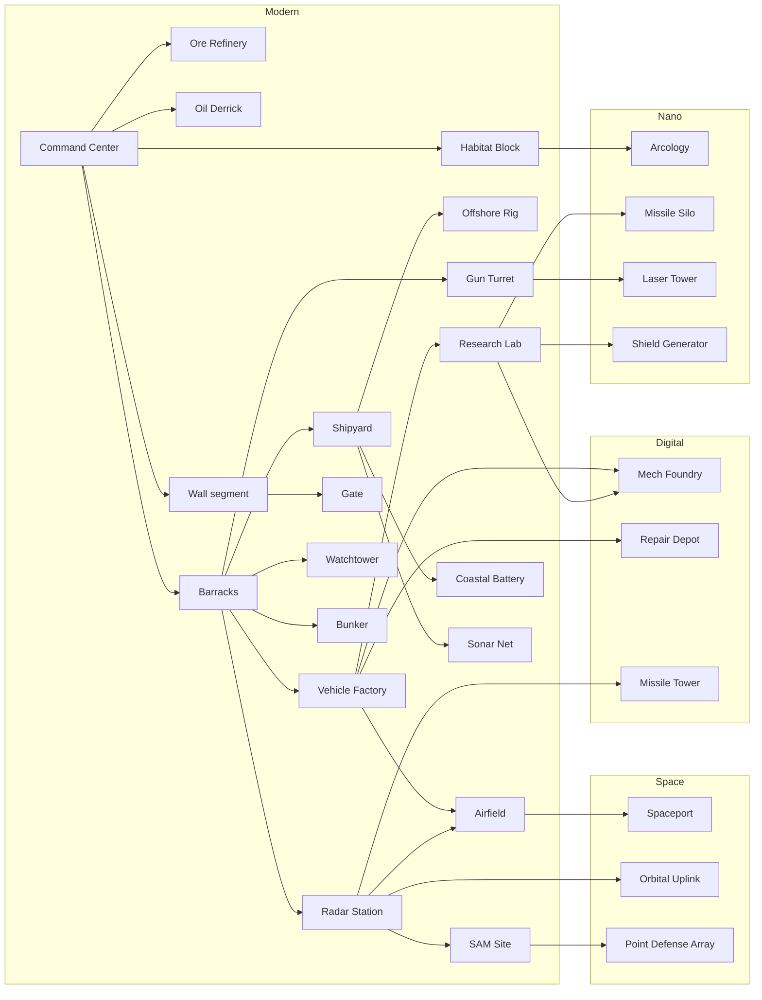

# Tech tree and catalog

The current data catalog: every building, unit and research by age, from the RTS
groundwork (M1–M3; the Modern age is playable). The economy-first design it is growing into
(goods, chains, citizen tiers, networks, trade) is in [DESIGN.md](DESIGN.md) and moves into
the data milestone by milestone. All numbers are **starting
values** for the balance harness to tune. The tables and the diagram in this file are
generated from `src/data/` by `npm run docs` (CI fails if they drift), so the docs and the
game never disagree. Edit the data, not the tables.

Costs are written `Ore / Energy`. Times are in seconds at normal game speed.

---

## 1. Ages

<!-- gen:ages -->
| Age | Theme | Advance cost | Time | Requirements (at the HQ) |
|---|---|---|---|---|
| **Modern** | Start. Tanks, destroyers, jets, concrete walls | — | — | — |
| **Digital** | Nuclear subs, carriers, stealth, first mech | 1200 / 800 | 60 | 2 of: Barracks, Vehicle Factory, Shipyard, Airfield |
| **Nano** | Heavy mechs, lasers, shields, EMP, nukes | 2500 / 2000 | 90 | Research Lab + Mech Foundry |
| **Space** | Orbital units, orbital strikes, Space Elevator wonder | 4000 / 3500 | 120 | 1 of: Missile Silo, Shield Generator |
<!-- /gen:ages -->

Advancing also upgrades all existing walls one tier (see §4) and unlocks that age's research.

---

## 2. Building prerequisites

<!-- gen:prereq_diagram -->

<!-- /gen:prereq_diagram -->

---

## 3. Buildings by category

<!-- gen:buildings -->
| Building | Category | Age | Requires | Cost | Build time | Size | Pop | Function |
|---|---|---|---|---|---|---|---|---|
| **Command Center** | Core | Modern | — | 1000 / 0 | 120 | 4×4 | +10 | Trains Engineers, accepts Ore, advances the age. Can garrison 10 infantry. |
| **Habitat Block** | Housing | Modern | Command Center | 100 / 0 | 20 | 2×2 | +10 | Housing: +10 population. |
| **Arcology** | Housing | Nano | Habitat Block | 300 / 150 | 45 | 3×3 | +30 | Large housing: +30 population. Slowly heals nearby infantry. |
| **Ore Refinery** | Resource | Modern | Command Center | 150 / 0 | 30 | 3×3 | — | Ore drop-off. Build it next to ore fields to shorten trips. Mining research. |
| **Oil Derrick** | Resource | Modern | Command Center | 100 / 0 | 25 | 2×2 | — | Built on land oil. Produces Energy on its own. Produces 1.5 energy/s. |
| **Offshore Rig** | Resource | Modern | Shipyard | 200 / 0 | 40 | 3×3 | — | Built on sea oil by a Sea Engineer. Pumps 2.5 oil/s into its tank; 1/s flows ashore by pipeline, Sea Engineers haul the rest to a Shipyard. Produces 2.5 energy/s. |
| **Barracks** | Military | Modern | Command Center | 200 / 0 | 35 | 3×3 | — | Trains infantry. |
| **Vehicle Factory** | Military | Modern | Barracks | 300 / 100 | 45 | 4×4 | — | Builds land vehicles. |
| **Shipyard** | Military | Modern | Barracks | 300 / 100 | 45 | 4×4 | — | Builds ships and submarines. Must touch the water. Sea Engineers unload oil here. |
| **Airfield** | Military | Modern | Radar Station + Vehicle Factory | 350 / 200 | 55 | 6×5 | — | Builds aircraft. 4 parking spots where planes land to refuel and repair. |
| **Mech Foundry** | Military | Digital | Research Lab + Vehicle Factory | 600 / 400 | 70 | 5×5 | — | Builds giant mechs. |
| **Spaceport** | Military | Space | Airfield | 800 / 800 | 80 | 5×5 | — | Builds orbital units. |
| **Radar Station** | Tech | Modern | Barracks | 200 / 50 | 30 | 2×2 | — | Large vision radius, enemy blips on the minimap, detects stealth aircraft. |
| **Research Lab** | Tech | Modern | Vehicle Factory | 300 / 200 | 50 | 3×3 | — | Global research. Needed on the path to the Nano Age. |
| **Repair Depot** | Support | Digital | Vehicle Factory | 250 / 100 | 35 | 3×3 | — | Repairs vehicles and mechs nearby. |
| **Missile Silo** | Special | Nano | Research Lab | 1500 / 1500 | 120 | 3×3 | — | Nuclear strike every 5 minutes. The enemy is warned 15 s before impact. Max 1. |
| **Orbital Uplink** | Special | Space | Radar Station | 1000 / 1200 | 90 | 3×3 | — | Orbital laser strike and satellite scan powers. Max 1. |
<!-- /gen:buildings -->

---

## 4. Defense: walls and towers

Turtling must be a real strategy, not a delay. Design rules:

- **Walls are cheap and fast.** Drag to draw a line; segments auto-connect and snap to
  cliffs and coasts. Gates open for your units only. Walls block land pathing.
- **Garrisoned towers are strong.** Infantry inside a Watchtower, Bunker, Missile Tower or
  the HQ fire from it with **+2 range, +50% damage reduction**, and the structure adds its
  own weapon. Each garrisoned unit adds firepower, so a full tower is a serious threat.
- **Height matters.** Towers get a range bonus and see over walls.
- **Walls get stronger with the ages.** Every age-up upgrades existing walls a tier.
- **Siege is a choice, not a given.** Artillery, bombers, mechs, EMP and nukes are the
  counters. Attacking a fortified base without them should fail. Attacking with them
  should win, but cost real investment.
- **Engineers repair** walls and towers (Energy-free, Ore cost proportional to damage).

<!-- gen:defense -->
| Structure | Age | Requires | Cost | Build time | HP | Garrison | Weapons | Notes |
|---|---|---|---|---|---|---|---|---|
| **Wall segment** | Modern | Command Center | 10 / 0 | 4 | 800 | — | — | Drag to draw a line. Concrete → Composite → Nanocrete (self-repairing) → Hardlight (blocks shots). |
| **Gate** | Modern | Wall segment | 50 / 0 | 12 | 1200 | — | — | Opens for your units only; lockable. |
| **Watchtower** | Modern | Barracks | 125 / 0 | 20 | 900 | 4 infantry | Machine gun: 10 bullet / 0.8s, range 8 | Garrison 4 infantry who fire with +2 range. Tall: extra vision and range. |
| **Bunker** | Modern | Barracks | 200 / 0 | 25 | 1800 | 6 infantry | Heavy machine gun: 14 bullet / 0.8s, range 6 | Garrison 6 infantry. Very high armor, weak to artillery. |
| **Gun Turret** | Modern | Barracks | 150 / 25 | 20 | 900 | — | Autocannon: 25 AP / 0.8s, range 8 | Auto-cannon. Good against light vehicles. |
| **SAM Site** | Modern | Radar Station | 200 / 100 | 25 | 800 | — | SAM battery: 60 AA / 2s, range 11 | Long-range anti-air. |
| **Coastal Battery** | Modern | Shipyard | 300 / 100 | 35 | 1500 | — | Coastal gun: 110 AP / 4s, range 13, splash 1 | Long-range heavy guns against ships. |
| **Sonar Net** | Modern | Shipyard | 100 / 50 | 15 | 300 | — | — | Placed on water. Reveals submerged submarines nearby. |
| **Missile Tower** | Digital | Radar Station | 350 / 200 | 35 | 1400 | 4 infantry | — | Garrisonable; hits ground and air. Can upgrade a Watchtower in place. |
| **Laser Tower** | Nano | Gun Turret | 400 / 300 | 35 | 1400 | — | — | Beam ramps up on the same target: shreds mechs and heavy armor. |
| **Shield Generator** | Nano | Research Lab | 800 / 600 | 60 | 1500 | — | — | Dome that absorbs damage to buildings inside until depleted, then recharges. |
| **Point Defense Array** | Space | SAM Site | 700 / 700 | 45 | 1500 | — | — | Shoots down missiles, shells, bombs and incoming nukes in its radius. |
<!-- /gen:defense -->

Defense research is listed with all other research in §7.

---

## 5. Units

Armor classes: **Inf** infantry, **Lt** light vehicle, **Hv** heavy vehicle, **Mech**, **Ship**,
**Sub**, **Air**, **Orb** orbital, **Str** structure.

### Modern age

<!-- gen:units_modern -->
| Unit | From | Class | Cost | Pop | HP | Speed | Weapons | Strong vs | Weak vs |
|---|---|---|---|---|---|---|---|---|---|
| **Engineer** | Command Center | Inf | 50 / 0 | 1 | 60 | 1.7 | — | — | everything |
| **Sea Engineer** | Shipyard | Ship | 120 / 0 | 1 | 200 | 3.2 | — | — | everything |
| **Rifleman** | Barracks | Inf | 50 / 0 | 1 | 80 | 1.6 | Assault rifle: 9 bullet / 1s, range 5 | infantry | light vehicles, artillery |
| **Rocket Trooper** | Barracks | Inf | 80 / 20 | 1 | 80 | 1.5 | Rocket launcher: 45 AP / 2.5s, range 6 | light and heavy vehicles | infantry |
| **Skyguard** | Barracks | Inf | 80 / 30 | 1 | 80 | 1.5 | Stinger missiles: 40 AA / 2.2s, range 7 | helicopters | infantry, light vehicles |
| **Scout Buggy** | Vehicle Factory | Lt | 80 / 20 | 1 | 160 | 4.2 | Machine gun: 12 bullet / 0.6s, range 5.5 | infantry, scouting | heavy vehicles, turrets |
| **Battle Tank** | Vehicle Factory | Hv | 250 / 75 | 3 | 600 | 2.4 | 120 mm cannon: 60 AP / 2.5s, range 7 | light and heavy vehicles | Rocket Troopers, helicopters |
| **Flak Track** | Vehicle Factory | Lt | 150 / 50 | 2 | 320 | 2.7 | Twin flak: 22 AA / 0.6s, range 8, splash 1 | aircraft | heavy vehicles |
| **Howitzer** | Vehicle Factory | Hv | 300 / 100 | 3 | 380 | 1.8 | 155 mm howitzer: 90 explosive / 5s, range 14 (min 4), splash 1.5 | structures, infantry (long range) | anything up close |
| **Patrol Boat** | Shipyard | Ship | 120 / 30 | 2 | 300 | 3.8 | Deck gun: 14 bullet / 0.7s, range 6 Depth charges: 40 torpedo / 3s, range 3, splash 1.5 | infantry on shore, submarines | Destroyer |
| **Destroyer** | Shipyard | Ship | 400 / 150 | 4 | 1200 | 2.6 | 127 mm gun: 70 AP / 2.5s, range 9 Depth charges: 60 torpedo / 3s, range 4, splash 1.5 | ships, submarines | aircraft |
| **Frigate** | Shipyard | Ship | 300 / 150 | 3 | 900 | 2.9 | SAM launcher: 45 AA / 1.5s, range 10 Autocannon: 12 bullet / 0.8s, range 6 | aircraft | ships |
| **Transport Ship** | Shipyard | Ship | 200 / 50 | 2 | 700 | 3 | — | — | everything |
| **Fighter Jet** | Airfield | Air | 250 / 150 | 2 | 300 | 8 | Air-to-air missiles: 50 AA / 1.8s, range 7 | aircraft | SAM, Flak |
| **Cargo Plane** | Airfield | Air | 250 / 150 | 2 | 500 | 6 | — | drops 8 paratroopers anywhere | fighters, anti-air |
| **Attack Helicopter** | Airfield | Air | 300 / 150 | 3 | 450 | 4.2 | Hellfire missiles: 40 AP / 1.6s, range 7 | light and heavy vehicles | Fighter, Skyguard |
<!-- /gen:units_modern -->

### Digital age

<!-- gen:units_digital -->
| Unit | From | Class | Cost | Pop | HP | Speed | Weapons | Strong vs | Weak vs |
|---|---|---|---|---|---|---|---|---|---|
| **Exo-Trooper** | Barracks | Inf | 150 / 75 | 2 | 220 | 1.9 | Heavy rifle: 18 bullet / 0.9s, range 6 | infantry, light vehicles | heavy vehicles |
| **Rocket Artillery** | Vehicle Factory | Hv | 450 / 250 | 4 | 450 | 2 | Rocket salvo: 70 explosive / 6s, range 18 (min 5), splash 2.2 | structures, groups (area damage, huge range) | fast units, aircraft |
| **Nuclear Submarine** | Shipyard | Sub | 700 / 400 | 5 | 1100 | 2.8 | — | ships (torpedoes); land targets with Cruise Missiles | Destroyer, Patrol Boat, Sonar Net |
| **Aircraft Carrier** (max 2) | Shipyard | Ship | 1200 / 700 | 8 | 3000 | 2 | — | projects air power to any coast (carries 6 Fighter Jets) | submarines; nearly defenceless alone |
| **Aegis Cruiser** | Shipyard | Ship | 650 / 400 | 5 | 1600 | 2.5 | — | aircraft, missiles | submarines |
| **Stealth Bomber** | Airfield | Air | 600 / 400 | 4 | 500 | 6 | — | structures, heavy vehicles | fighters once detected |
| **Warden** | Mech Foundry | Mech | 900 / 500 | 6 | 2200 | 1.9 | Twin autocannons: 38 AP / 1s, range 7 Anti-personnel guns: 14 bullet / 0.5s, range 6 | infantry, light vehicles | massed Rocket Troopers, Laser Tower |
<!-- /gen:units_digital -->

### Nano age

<!-- gen:units_nano -->
| Unit | From | Class | Cost | Pop | HP | Speed | Weapons | Strong vs | Weak vs |
|---|---|---|---|---|---|---|---|---|---|
| **Disruptor** | Vehicle Factory | Lt | 400 / 300 | 3 | 400 | 2.6 | Pulse cannon: 38 laser / 1.2s, range 6.5 | mechs and vehicles (EMP stun), shields | infantry |
| **Juggernaut** | Mech Foundry | Mech | 1800 / 1200 | 10 | 5000 | 1.5 | Arm cannons: 120 AP / 2.2s, range 8, splash 1 Shoulder rockets: 50 explosive / 3s, range 9 | structures, heavy vehicles; smashes walls | Disruptor, Arclight, Laser Tower |
| **Arclight** | Mech Foundry | Mech | 1500 / 1300 | 8 | 3500 | 1.8 | Eye laser: 90 laser / 1.6s, range 9 | mechs, heavy vehicles (eye laser) | infantry swarms, aircraft |
| **Leviathan** | Mech Foundry | Mech | 2000 / 1500 | 10 | 5000 | 1.6 | — | ships and coasts (walks the seabed, hidden while submerged) | submarines, Disruptor |
| **Nano Swarm** | Research Lab | Air | 200 / 200 | 2 | 150 | 3.5 | — | repairs friendly units in an area | everything (fragile) |
<!-- /gen:units_nano -->

### Space age

<!-- gen:units_space -->
| Unit | From | Class | Cost | Pop | HP | Speed | Weapons | Strong vs | Weak vs |
|---|---|---|---|---|---|---|---|---|---|
| **Orbital Fighter** | Spaceport | Orb | 600 / 600 | 3 | 600 | 10 | — | aircraft, orbital units | Point Defense, SAM (reduced) |
| **Drop Ship** | Spaceport | Orb | 800 / 800 | 4 | 1200 | 5 | — | carries 1 mech or 10 infantry anywhere, lands behind walls | anti-air |
| **Star Lance** (max 1) | Spaceport | Orb | 3000 / 3000 | 15 | 12000 | 1.4 | — | everything below it | Orbital Fighters in numbers, orbital laser |
<!-- /gen:units_space -->

Unit caps are shown next to the unit name.

---

## 6. Damage vs armor

Damage multiplier by weapon type (rows) against armor class (columns). `—` = no effect.
In game, a hit does *weapon damage × this multiplier × upgrades*.

<!-- gen:damage -->
|  | Inf | Lt | Hv | Mech | Ship | Sub | Air | Orb | Str |
|---|---|---|---|---|---|---|---|---|---|
| Bullet | 1 | 0.6 | 0.2 | 0.15 | 0.2 | — | 0.3 | — | 0.15 |
| Armor-piercing | 0.4 | 1.2 | 1 | 0.8 | 0.8 | — | — | — | 0.6 |
| Explosive | 1.2 | 0.9 | 0.7 | 0.6 | 0.7 | — | — | — | 1.5 |
| Anti-air missile | — | — | — | — | — | — | 1.5 | 0.8 | — |
| Torpedo / depth charge | — | — | — | 0.8 | 1.5 | 1.5 | — | — | 0.5 |
| Laser | 0.8 | 1 | 1.3 | 1.5 | 1 | — | 1 | 1 | 0.8 |
| EMP | — | 0.2 | 0.2 | 0.4 | 0.2 | — | — | — | 0.1 |
<!-- /gen:damage -->

EMP (Nano Age) also stuns vehicles and mechs and drains shields; that effect arrives with E8.

\* Torpedo vs mech applies to Leviathan in water; vs structures to coastal buildings.

---

## 7. Research by building and age

<!-- gen:research_grid -->
| Building | Modern | Digital | Nano | Space |
|---|---|---|---|---|
| **Command Center** | Fortified Masonry; Efficient Logistics | Command Network | — | Planetary Defense Grid |
| **Ore Refinery** | Deep Drilling | Automated Mining | Nano Extraction | Asteroid Capture |
| **Barracks** | Body Armor; Murder Holes | Hardened Garrison; Exoskeletons | Nano Weave | — |
| **Vehicle Factory** | Composite Armor | Reactive Armor; Railguns | Hover Drives | — |
| **Shipyard** | Sonar | Cruise Missiles; Nuclear Propulsion | Supercavitation | — |
| **Airfield** | Afterburners | Stealth Coating; Precision Munitions | Drone Wingmen | — |
| **Radar Station** | Targeting Radar | Electronic Warfare | — | Satellite Network |
| **Research Lab** | Advanced Ballistics | Automated Repair | Shield Tech; Overcharged Lasers | Layered Shields; Fusion Engines |
| **Mech Foundry** | — | Reinforced Frames | Overclocked Reactors; Ablative Plating | Jump Jets |
| **Spaceport** | — | — | — | Orbital Mechanics; Kinetic Rods |
<!-- /gen:research_grid -->

Full list, with what each does and from which milestone it works in game:

<!-- gen:research -->
| Research | At | Age | Cost | Time | Effect | In game |
|---|---|---|---|---|---|---|
| **Fortified Masonry** | Command Center | Modern | 150 / 0 | 30 | Walls and gates +30% HP | yes |
| **Efficient Logistics** | Command Center | Modern | 200 / 50 | 40 | Build speed +20% | yes |
| **Command Network** | Command Center | Digital | 400 / 300 | 50 | +5 garrison slots in the HQ | from E7 |
| **Planetary Defense Grid** | Command Center | Space | 1000 / 1000 | 80 | HQ gains a Point Defense Array | from E9 |
| **Deep Drilling** | Ore Refinery | Modern | 150 / 50 | 35 | +15% Ore gathering | yes |
| **Automated Mining** | Ore Refinery | Digital | 300 / 150 | 45 | +20% Ore gathering | yes |
| **Nano Extraction** | Ore Refinery | Nano | 600 / 400 | 60 | +25% Ore gathering | yes |
| **Asteroid Capture** | Ore Refinery | Space | 1000 / 1000 | 80 | Passive Ore trickle | from E9 |
| **Body Armor** | Barracks | Modern | 150 / 50 | 35 | Infantry +20% HP | yes |
| **Murder Holes** | Barracks | Modern | 100 / 50 | 30 | Garrisoned infantry +1 more range | yes |
| **Hardened Garrison** | Barracks | Digital | 300 / 200 | 45 | Garrison damage reduction 50% → 70% | from E7 |
| **Exoskeletons** | Barracks | Digital | 250 / 150 | 40 | Infantry speed +20% | from E7 |
| **Nano Weave** | Barracks | Nano | 400 / 300 | 50 | Infantry regenerate HP | from E8 |
| **Composite Armor** | Vehicle Factory | Modern | 250 / 100 | 45 | Vehicles +15% HP | yes |
| **Reactive Armor** | Vehicle Factory | Digital | 400 / 250 | 55 | Vehicles take -20% missile damage | from E7 |
| **Railguns** | Vehicle Factory | Digital | 450 / 300 | 55 | Tanks +range | from E7 |
| **Hover Drives** | Vehicle Factory | Nano | 600 / 500 | 60 | Vehicles cross shallow water | from E8 |
| **Sonar** | Shipyard | Modern | 150 / 100 | 35 | +Submarine detection range | from E7 |
| **Cruise Missiles** | Shipyard | Digital | 500 / 400 | 55 | Submarines can strike land targets | from E7 |
| **Nuclear Propulsion** | Shipyard | Digital | 400 / 300 | 50 | Ships +15% speed | from E7 |
| **Supercavitation** | Shipyard | Nano | 500 / 500 | 55 | Faster torpedoes | from E8 |
| **Afterburners** | Airfield | Modern | 200 / 150 | 40 | Aircraft +15% speed | yes |
| **Stealth Coating** | Airfield | Digital | 500 / 400 | 55 | Aircraft harder to detect | from E7 |
| **Precision Munitions** | Airfield | Digital | 400 / 300 | 50 | Aircraft +15% damage | from E7 |
| **Drone Wingmen** | Airfield | Nano | 600 / 600 | 60 | Fighters launch escort drones | from E8 |
| **Targeting Radar** | Radar Station | Modern | 200 / 100 | 40 | Towers and turrets +15% range | yes |
| **Electronic Warfare** | Radar Station | Digital | 400 / 400 | 50 | Scrambles enemy minimap blips near you | from E7 |
| **Satellite Network** | Radar Station | Space | 800 / 800 | 70 | Permanent reveal of the enemy HQ | from E9 |
| **Advanced Ballistics** | Research Lab | Modern | 300 / 200 | 45 | All weapons +10% damage | yes |
| **Automated Repair** | Research Lab | Digital | 400 / 300 | 50 | Defenses self-repair out of combat | from E7 |
| **Shield Tech** | Research Lab | Nano | 600 / 600 | 60 | Unlocks Shield Generator | from E8 |
| **Overcharged Lasers** | Research Lab | Nano | 600 / 500 | 55 | Laser Tower ramps up twice as fast | from E8 |
| **Layered Shields** | Research Lab | Space | 800 / 800 | 70 | Shield Generator capacity +50% | from E9 |
| **Fusion Engines** | Research Lab | Space | 800 / 800 | 70 | Orbital units +20% speed | from E9 |
| **Reinforced Frames** | Mech Foundry | Digital | 500 / 300 | 50 | Mechs +15% HP | from E7 |
| **Overclocked Reactors** | Mech Foundry | Nano | 600 / 500 | 55 | Mechs +20% speed | from E8 |
| **Ablative Plating** | Mech Foundry | Nano | 700 / 600 | 60 | Mechs take -20% laser damage | from E8 |
| **Jump Jets** | Mech Foundry | Space | 900 / 900 | 70 | Mechs leap cliffs and walls | from E9 |
| **Orbital Mechanics** | Spaceport | Space | 800 / 800 | 60 | Orbital units +speed | from E9 |
| **Kinetic Rods** | Spaceport | Space | 1200 / 1200 | 80 | Star Lance bombardment | from E9 |
<!-- /gen:research -->

---

## 8. What counters what (summary)

- **Walls + garrisoned towers** beat early infantry and vehicle rushes → answered by
  **Howitzers / Rocket Artillery / bombers / Juggernauts**.
- **Artillery** → answered by fast units, helicopters, bombers, Laser Towers at range.
- **Nuclear subs** → **Destroyers, Patrol Boats, Sonar Nets**.
- **Carriers** → **subs** (and Leviathans).
- **Stealth bombers** → **Radar + SAM**, Aegis Cruisers.
- **Mechs** → **Disruptors (EMP), Arclights, Laser Towers**, Rocket Troopers en masse.
- **Nukes** → spread out, **Point Defense Array** (Space age).
- **Drop Ships behind walls** → interior towers, Point Defense, Orbital Fighters.
- **Space Elevator** → everything; it forces the defender out of their walls.

---

## 9. Economy game (Modern age)

The economy-first game described in [DESIGN.md](DESIGN.md). Buildings cost credits when placed;
their materials are delivered by truck and a construction crew builds them. A game year is 120
seconds at normal speed.

### Buildings

<!-- gen:city_buildings -->
| Building | Category | Size | Price | Materials | Upkeep /yr | Staff | Makes | Notes |
|---|---|---|---|---|---|---|---|---|
| **Fusion Plant** | Utility | 5×5 | ₡15000 | 100 concrete + 60 steel + 10 nanomaterials | 800 | 6 scientists | power every 10s; 250 MW | Nano age. 250 MW from seawater fusion: no fuel, no smoke. Needs scientists. |
| **Space Elevator** | Service | 6×6 | ₡150000 | 400 concrete + 300 steel + 100 nanomaterials + 60 orbital alloys | 4000 | 20 scientists | — | Space age wonder. A cable to orbit. Keep it staffed and powered for 5 years and your nation wins. needs 100 MW max 1 |
| **Town Hall** | Core | 5×5 | ₡0 | — | 0 | — | stores 500 | Seat of government. Stores goods, sends trucks and runs two construction crews. Its militia and up to 8 garrisoned infantry defend it: lose it and its region falls. 2 trucks 2 crews max 1 |
| **Regional Office** | Core | 3×3 | ₡2500 | 30 lumber + 20 concrete | 150 | 4 workers | — | Claims an unclaimed region next to yours once built. Place it inside that region and connect it by road. |
| **Maintenance Depot** | Logistics | 3×2 | ₡700 | 10 lumber + 20 concrete | 90 | 6 workers | — | Road crews repair worn roads within 30 road tiles, worst first. Worn roads slow every truck down. |
| **Construction Office** | Logistics | 3×3 | ₡900 | 20 lumber + 10 concrete | 120 | 6 workers | — | Three more construction crews: build faster, in more places at once. 3 crews |
| **Warehouse** | Logistics | 4×3 | ₡600 | 30 lumber + 10 concrete | 80 | 6 workers | stores 400 | Takes in what producers make and sends it on to whoever needs it. Three trucks. 3 trucks |
| **Rail Station** | Logistics | 4×2 | ₡2000 | 20 lumber + 20 concrete + 20 steel | 160 | 6 workers | stores 300 | A warehouse on the railway: its train carries 60 units at a time, fast, to other stations on the same line whose surroundings need them. Trucks bring it what the other stations want. Must touch a railway and a road. 3 trucks |
| **Cargo Airport** | Logistics | 6×4 | ₡9000 | 80 concrete + 30 steel | 600 | 10 technicians | stores 300 | Digital age. A warehouse with a cargo plane: it flies 30 units at a time to any of your other airports whose surroundings need them. No track needed. needs 8 MW 3 trucks |
| **Coast Guard** | Logistics | 3×3 | ₡1500 | 15 lumber + 15 concrete + 5 steel | 150 | 6 workers | — | Patrol boats keep pirates away from your trade ports within 40 tiles. Without one, about one cargo ship in ten is raided (from 1955). |
| **Trade Port** | Logistics | 4×3 | ₡3000 | 50 lumber | 200 | 8 workers | stores 400 | Trade with the overseas market: cargo ships take your surplus and bring what you lack (set it in 🚢 Trade). Must be on a coast that reaches the open sea. 6 trucks |
| **House** | Housing | 2×2 | ₡60 | — | 0 | — | 8 / 16 / 24 / 40 / 64 / 96 residents by level | Settlers build it themselves once it has a road. Grows from cottage to apartment (to a tower in the Digital age, a spire in the Nano age) as its needs are met. |
| **Farm** | Resource | 4×4 | ₡400 | 10 lumber | 30 | 6 workers | 4 crops every 20s | Grows crops. Fertile floodplain yields full output, grassland 60%, sand 20%. 1 truck |
| **Fishing Harbour** | Resource | 3×3 | ₡500 | 15 lumber | 40 | 4 workers | 3 food every 12s | Lands fish straight as food. Output depends on open water nearby. 1 truck |
| **Logging Camp** | Resource | 2×2 | ₡250 | — | 20 | 4 workers | 4 timber every 18s | Fells timber. Output depends on forest within 5 tiles. 1 truck |
| **Quarry** | Resource | 3×3 | ₡400 | 10 lumber | 40 | 6 workers | 4 stone every 18s | Cuts stone. Must stand on a stone deposit; more deposit under it, more output. 1 truck |
| **Iron Mine** | Resource | 3×3 | ₡600 | 15 lumber + 5 concrete | 60 | 8 workers | 4 iron ore every 18s | Digs iron ore. Must stand on an ore deposit. 1 truck |
| **Oil Well** | Resource | 2×2 | ₡700 | 5 steel + 5 concrete | 60 | 4 workers | 4 crude oil every 16s | Pumps crude oil. Must stand on an oil deposit. 1 truck |
| **Rare-Earth Mine** | Resource | 3×3 | ₡1200 | 15 concrete + 10 steel | 90 | 8 workers | 3 rare earths every 20s | Digital age. Digs rare earths for electronics. Must stand on a rare-earth deposit (green). 1 truck |
| **Uranium Mine** | Resource | 3×3 | ₡1500 | 20 concrete + 10 steel | 110 | 8 workers | 2 uranium every 24s | Digital age. Mines uranium for nuclear power. Must stand on a uranium deposit (yellow-green). 1 truck |
| **Food Plant** | Industry | 3×3 | ₡700 | 20 lumber + 10 concrete | 60 | 8 workers | 2 crops → 3 food every 10s | Turns crops into food. 1 truck |
| **Sawmill** | Industry | 3×3 | ₡500 | 10 lumber | 40 | 6 workers | 2 timber → 2 lumber every 8s | Saws timber into lumber. 1 truck |
| **Cement Works** | Industry | 3×3 | ₡800 | 20 lumber + 5 steel | 70 | 8 workers | 2 stone → 2 concrete every 8s | Grinds and fires stone into concrete. Needs power. needs 4 MW 1 truck |
| **Steel Mill** | Industry | 4×4 | ₡1500 | 20 lumber + 30 concrete | 120 | 12 workers | 2 iron ore → 1 steel every 8s | Smelts iron ore into steel. Needs a lot of power. needs 10 MW 1 truck |
| **Oil Refinery** | Industry | 4×4 | ₡1600 | 20 steel + 20 concrete | 120 | 10 workers | 2 crude oil → 1 fuel + 1 plastics every 8s | Splits crude oil into fuel and plastics. needs 6 MW 2 trucks |
| **Goods Factory** | Industry | 3×3 | ₡1400 | 15 steel + 15 concrete | 100 | 10 technicians | 1 steel + 1 plastics → 2 consumer goods every 10s | Makes consumer goods from steel and plastics. Needs technicians. needs 6 MW 1 truck |
| **Electronics Plant** | Industry | 4×3 | ₡3000 | 30 concrete + 20 steel | 220 | 12 technicians | 2 rare earths + 1 plastics → 2 electronics every 12s | Digital age. Electronics from rare earths and plastics. Needs technicians and power. needs 10 MW 1 truck |
| **Nano Fab** | Industry | 4×4 | ₡9000 | 60 concrete + 40 steel + 20 electronics | 600 | 8 scientists | 1 rare earths + 1 electronics → 1 nanomaterials every 15s | Nano age. Nanomaterials from rare earths and electronics. Needs scientists and 30 MW. needs 30 MW 1 truck |
| **Robotics Plant** | Industry | 4×3 | ₡7000 | 50 concrete + 40 steel + 10 electronics | 450 | 10 engineers | 2 steel + 1 electronics + 1 nanomaterials → 2 robotics every 15s | Nano age. Robots from steel, electronics and nanomaterials. Farms, mines and factories stocked with robots need half the staff. needs 15 MW 1 truck |
| **Launch Site** | Industry | 5×5 | ₡25000 | 150 concrete + 100 steel + 20 nanomaterials | 1500 | 10 scientists | 6 fuel + 2 electronics + 1 nanomaterials → 3 orbital alloys every 30s | Space age. Sends mining craft to the asteroids; they bring back orbital alloys. Burns fuel, electronics and nanomaterials. Needs scientists. needs 40 MW 2 trucks |
| **Pharmaceutical Plant** | Industry | 3×3 | ₡2600 | 30 concrete + 10 steel | 200 | 8 engineers | 2 crops + 1 plastics → 2 pharmaceuticals every 12s | Digital age. Medicines from crops and plastics, for hospitals. Needs engineers. needs 6 MW 1 truck |
| **Oil Power Plant** | Utility | 4×3 | ₡1200 | 10 lumber + 20 concrete + 10 steel | 100 | 6 workers | 1 crude oil → power every 6s; 30 MW | Burns crude oil: 30 MW for every building connected to it by road. |
| **Hydro Plant** | Utility | 3×3 | ₡2200 | 40 concrete + 10 steel | 120 | 4 workers | power every 10s; 20 MW | A dam on a river or lake: 20 MW with no fuel. Needs concrete and steel to build. |
| **Nuclear Plant** | Utility | 4×4 | ₡6000 | 80 concrete + 40 steel | 400 | 8 engineers | 1 uranium → power every 30s; 100 MW | Digital age. 100 MW from a little uranium, with no smoke. Needs engineers. |
| **Orbital Solar Relay** | Utility | 4×4 | ₡20000 | 60 concrete + 40 steel + 10 orbital alloys | 900 | 4 scientists | 1 orbital alloys → power every 60s; 400 MW | Space age. Beams down sunlight collected in orbit: 400 MW. Needs a little orbital alloy to maintain. |
| **Pumping Station** | Utility | 2×2 | ₡500 | 10 concrete + 5 steel | 50 | 2 workers | water for 600 | Pumps river or lake water for 600 residents. Water Towers spread it to houses. |
| **Water Well** | Utility | 2×2 | ₡400 | 5 lumber + 5 concrete | 40 | 2 workers | water for 200 | Groundwater for 200 residents, anywhere: for towns far from rivers and lakes. Water Towers spread it to houses. |
| **Water Tower** | Utility | 2×2 | ₡250 | 5 concrete + 2 steel | 20 | — | water: 400 residents within 24 road tiles | Gives running water to houses within 24 road tiles, fed by a Pumping Station on the same roads. |
| **Market** | Service | 3×3 | ₡400 | 15 lumber | 40 | 4 workers | market: 500 residents within 26 road tiles | Sells food, consumer goods, and later electronics and pharmaceuticals, to households within 26 road tiles. Trucks keep it stocked. |
| **Police Station** | Service | 2×2 | ₡500 | 10 lumber + 10 concrete | 90 | 4 workers | police: 600 residents within 28 road tiles | Keeps the peace within 28 road tiles. Terraces and apartments need it. |
| **Clinic** | Service | 3×2 | ₡700 | 15 concrete + 5 steel | 120 | 4 technicians | health: 500 residents within 26 road tiles | Healthcare within 26 road tiles. Apartments need it. needs 2 MW |
| **School** | Service | 3×3 | ₡700 | 15 lumber + 15 concrete | 120 | 4 technicians | school: 500 residents within 26 road tiles | Education within 26 road tiles. Apartments need it. |
| **Hospital** | Service | 4×3 | ₡3000 | 40 concrete + 15 steel | 300 | 10 technicians | 1 pharmaceuticals → power every 20s; health: 1600 residents within 40 road tiles | Digital age. Healthcare for 1,600 residents within 40 road tiles, while trucks bring it pharmaceuticals. needs 6 MW |
| **Research Institute** | Service | 3×3 | ₡3500 | 40 concrete + 20 steel | 300 | 8 technicians | — | Research towards the next age (see 🔬 Ages). Needs technicians and power. needs 6 MW |
| **University** | Service | 4×4 | ₡6000 | 50 concrete + 20 steel + 20 lumber | 500 | 8 engineers | university: 1200 residents within 36 road tiles | Digital age. Twice the research of an institute, and higher education for 1,200 residents within 36 road tiles (Nano-age spires need it). Needs engineers. needs 6 MW |
| **Data Exchange** | Service | 2×2 | ₡1200 | 10 concrete + 5 steel | 120 | 3 technicians | data: 800 residents within 32 road tiles | Digital age. Connects houses within 32 road tiles to the data network. Towers need it. needs 3 MW |
<!-- /gen:city_buildings -->

### Goods

<!-- gen:goods -->
| Good | Reference price | Made by | Used by |
|---|---|---|---|
| 🌾 **Crops** | ₡4 | Farm | Food Plant, Pharmaceutical Plant |
| 🍞 **Food** | ₡9 | Fishing Harbour, Food Plant | households (markets) |
| 🪵 **Timber** | ₡3 | Logging Camp | Sawmill |
| 🪚 **Lumber** | ₡8 | Sawmill | Regional Office (construction), Maintenance Depot (construction), Construction Office (construction), Warehouse (construction), Rail Station (construction), Coast Guard (construction), Trade Port (construction), Farm (construction), Fishing Harbour (construction), Quarry (construction), Iron Mine (construction), Food Plant (construction), Sawmill (construction), Cement Works (construction), Steel Mill (construction), Oil Power Plant (construction), Water Well (construction), Market (construction), Police Station (construction), School (construction), University (construction) |
| 🪨 **Stone** | ₡3 | Quarry | Cement Works |
| 🧱 **Concrete** | ₡10 | Cement Works | Fusion Plant (construction), Space Elevator (construction), Regional Office (construction), Maintenance Depot (construction), Construction Office (construction), Warehouse (construction), Rail Station (construction), Cargo Airport (construction), Coast Guard (construction), Iron Mine (construction), Oil Well (construction), Rare-Earth Mine (construction), Uranium Mine (construction), Food Plant (construction), Steel Mill (construction), Oil Refinery (construction), Goods Factory (construction), Electronics Plant (construction), Nano Fab (construction), Robotics Plant (construction), Launch Site (construction), Pharmaceutical Plant (construction), Oil Power Plant (construction), Hydro Plant (construction), Nuclear Plant (construction), Orbital Solar Relay (construction), Pumping Station (construction), Water Well (construction), Water Tower (construction), Police Station (construction), Clinic (construction), School (construction), Hospital (construction), Research Institute (construction), University (construction), Data Exchange (construction) |
| ⛏ **Iron ore** | ₡5 | Iron Mine | Steel Mill |
| 🔩 **Steel** | ₡22 | Steel Mill | Goods Factory, Robotics Plant, Fusion Plant (construction), Space Elevator (construction), Rail Station (construction), Cargo Airport (construction), Coast Guard (construction), Oil Well (construction), Rare-Earth Mine (construction), Uranium Mine (construction), Cement Works (construction), Oil Refinery (construction), Goods Factory (construction), Electronics Plant (construction), Nano Fab (construction), Robotics Plant (construction), Launch Site (construction), Pharmaceutical Plant (construction), Oil Power Plant (construction), Hydro Plant (construction), Nuclear Plant (construction), Orbital Solar Relay (construction), Pumping Station (construction), Water Tower (construction), Clinic (construction), Hospital (construction), Research Institute (construction), University (construction), Data Exchange (construction) |
| 🛢 **Crude oil** | ₡6 | Oil Well | Oil Refinery, Oil Power Plant |
| ⛽ **Fuel** | ₡14 | Oil Refinery | Launch Site |
| 🧴 **Plastics** | ₡12 | Oil Refinery | Goods Factory, Electronics Plant, Pharmaceutical Plant |
| 📦 **Consumer goods** | ₡30 | Goods Factory | households (markets) |
| 🧲 **Rare earths** | ₡14 | Rare-Earth Mine | Electronics Plant, Nano Fab |
| ☢ **Uranium** | ₡24 | Uranium Mine | Nuclear Plant |
| 💾 **Electronics** | ₡55 | Electronics Plant | Nano Fab, Robotics Plant, Launch Site, households (markets), Nano Fab (construction), Robotics Plant (construction) |
| 💊 **Pharmaceuticals** | ₡45 | Pharmaceutical Plant | Hospital, households (markets) |
| ⚛ **Nanomaterials** | ₡120 | Nano Fab | Robotics Plant, Launch Site, Fusion Plant (construction), Space Elevator (construction), Launch Site (construction) |
| 🤖 **Robotics** | ₡150 | Robotics Plant | — |
| 🛰 **Orbital alloys** | ₡260 | Launch Site | Orbital Solar Relay, Space Elevator (construction), Orbital Solar Relay (construction) |
<!-- /gen:goods -->

### Houses

Houses level up when every need of the next level has been met for 15 seconds, and shrink back
when a need of their current level has been missing for 30 seconds.

<!-- gen:house_levels -->
| Level | Residents | Tier | Taxes per resident /yr | Needs |
|---|---|---|---|---|
| **Cottage** | 8 | Workers | ₡10 | a road |
| **House** | 16 | Workers | ₡10 | food, water |
| **Terrace** | 24 | Technicians | ₡22 | food, water, power, police |
| **Apartment** | 40 | Technicians | ₡22 | food, water, goods, power, police, health, school |
| **Tower** | 64 | Engineers | ₡40 | food, water, goods, power, police, health, school, electronics, data |
| **Spire** | 96 | Scientists | ₡70 | food, water, goods, power, police, health, school, electronics, data, pharma, university |
<!-- /gen:house_levels -->
